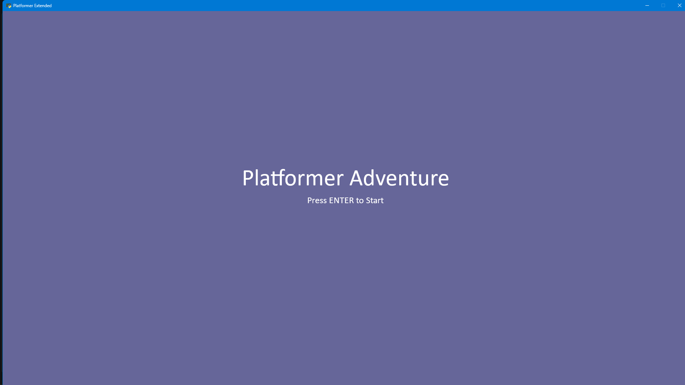
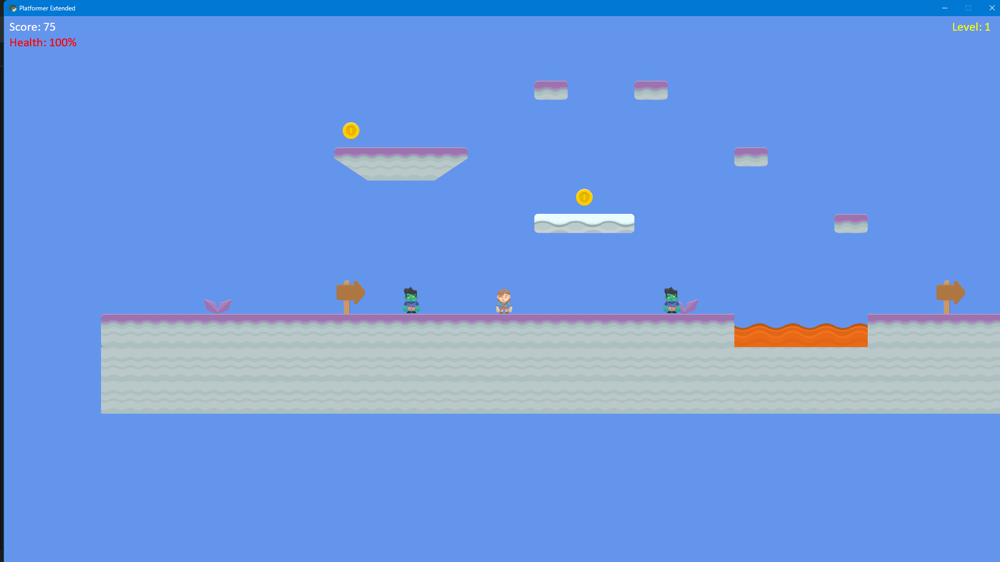
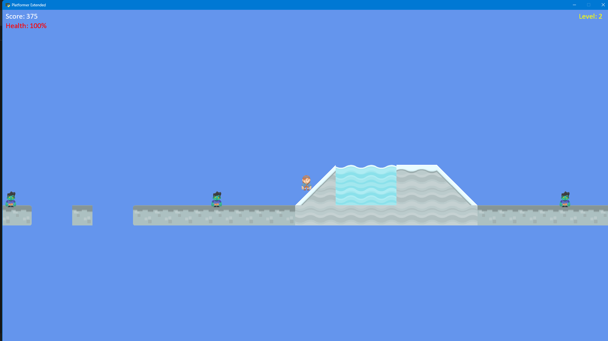
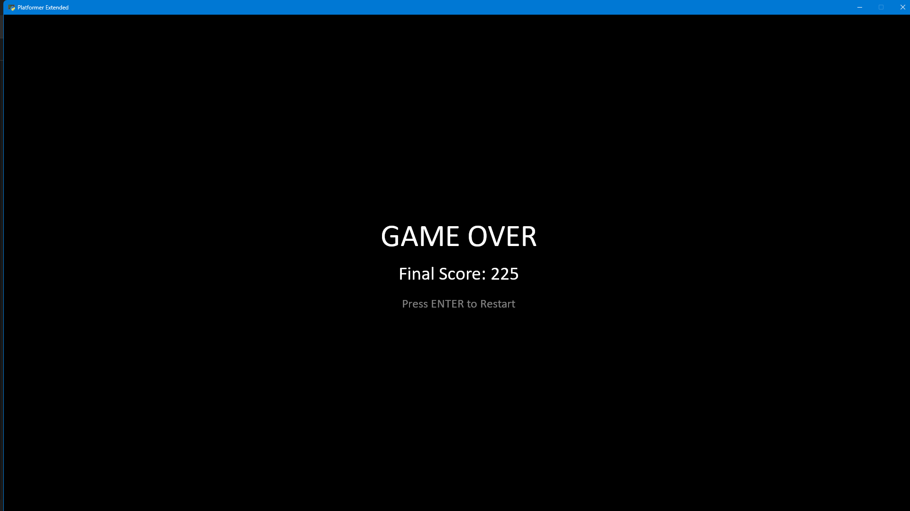

# Platformer Adventure

A complete 2D platformer game (everything is bundled no need to worry about missing assets :) ) built with Python's [Arcade](https://api.arcade.academy/) library. Run, jump, collect coins, dodge patrolling zombies, and clear **3 levels** to win; with an animated player, a health system, and full menu/game-over flow.

   

## Features

- **Animated player character** - idle, walk, jump, and fall animations with directional flipping
- **Patrolling enemies** - zombies that flip direction at boundaries and deal damage on contact
- **Coin collection** - with sound effects and score tracking
- **Health system** - lose 25% HP per enemy hit, with knockback
- **3 levels** - with increasing enemy count and layouts
- **State management** - Main Menu → Game → Game Over/Restart
- **Camera** - that follows the player across large tilemaps

## Requirements

- **Python 3.12**
- `arcade` library

## Installation

```bash
# Clone the repo
git clone https://github.com/einye/arcade-platformer.git
cd arcade-platformer

# (Recommended) Create a virtual environment
python3 -m venv venv
source venv/bin/activate        # Windows: venv\Scripts\activate

# Install dependencies
pip install arcade
```
## Acknowledgements

- Python arcade library tutorials - https://api.arcade.academy/en/stable/tutorials/platform_tutorial/index.html
- Arcade's built-in :resources: - sprites, sounds, and tilemaps
- Kenney Assets - original animated character sprites (via Arcade resources)